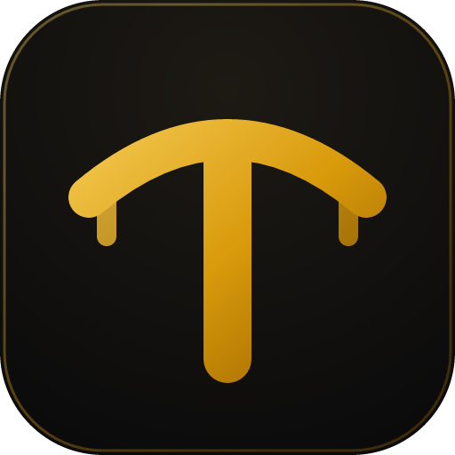
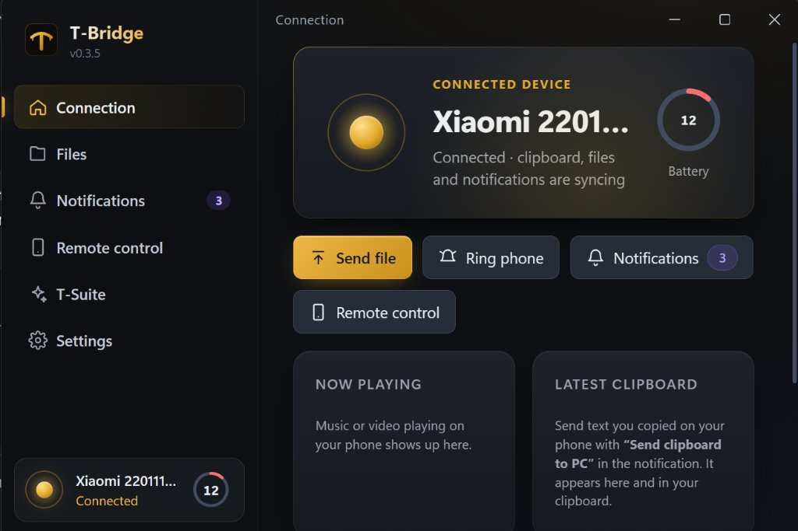
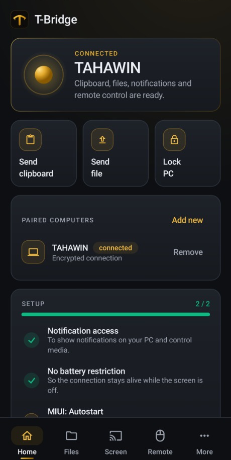

<div align="center">



<h1>T-Bridge</h1>

<p>
  <strong>Windows ve Android arasında kablo, bulut veya hesap olmadan çalışan; şifreli, yüksek hızlı yerel Wi-Fi köprüsü ve T-Suite kontrol merkezi.</strong>
</p>

<p>
  <a href="https://github.com/taha-sa/t-bridge-releases/releases/latest">
    
  </a>
  
  
  <a href="https://github.com/taha-sa/t-bridge-releases/releases">
    
  </a>
</p>

<p>
  <a href="#-öne-çıkan-özellikler">Özellikler</a> •
  <a href="#-indir-ve-kur">İndir & Kur</a> •
  <a href="#-cihaz-uyumluluğu-ve-gereksinimler">Uyumluluk</a> •
  <a href="#-gizlilik-ve-güvenlik">Güvenlik</a> •
  <a href="#-t-suite-ekosistemi">T-Suite</a>
</p>

</div>

<p align="center">
  
  
</p>

> **Not:** Bu depo yalnızca resmi derlenmiş Windows kurulum paketlerini, imzalı Android APK'yı, otomatik güncelleyici manifestlerini ve `SHA-256` doğrulama özetlerini barındırır.

---

## ✨ Öne Çıkan Özellikler

| Özellik | Detay |
|---|---|
| 📁 **Çift Yönlü Dosya & Klasör Aktarımı** | Büyük dosyaları ve tüm klasörleri boyut kısıtlaması olmadan yerel Wi-Fi ağınızın tam hızında PC ↔ Android arasında aktarın. Android **Paylaş** menüsünden tek dokunuşla bilgisayara gönderin. |
| 📋 **Anlık Pano (Clipboard) Senkronizasyonu** | Telefonda kopyaladığınız bağlantı veya metni anında bilgisayarda yapıştırın; bilgisayarda kopyaladığınız metin doğrudan telefon panosuna gelsin. |
| 🔔 **Canlı Bildirim Aynalama** | Android bildirimlerinizi masanızdan kalkmadan bilgisayar ekranında görüntüleyin ve yönetin. |
| 🎛️ **Uzaktan Kumanda & Medya Kontrolü** | Telefonunuzdan bilgisayar ses seviyesini ayarlayın, medya oynatımını (oynat/duraklat/ileri/geri) yönetin ve ekran akışı/kontrolünü kullanın. |
| 🎯 **Kablosuz Sunum Köprüsü** | **T-Desk Viewer** üzerinden açtığınız PDF/PPTX sunumlarını tek dokunuşla bilgisayar ekranına aktarın; telefonunuzu sunum kumandasına dönüştürün. |
| 🧩 **T-Suite Yönetim Merkezi (Hub)** | Bilgisayarınızdaki **T-Downloader**, **T-RamCash** ve **T-DeskTree** uygulamalarının açık/kapalı durumunu tek ekrandan izleyin, başlatın/öne getirin ve **"Tümünü Güncelle"** ile tek tıkla güncelleyin. |
| 📲 **QR & 5 Haneli Kodla Hızlı Eşleştirme** | Karmaşık IP yapılandırması yok — QR kodu okutun veya 5 haneli eşleştirme kodunu girin, saniyeler içinde bağlanın. |
| 🔄 **Uygulama İçi Otomatik Güncelleme** | Hem Windows (imzalı Tauri güncelleyici) hem Android (uygulama içi APK güncelleyici) yeni sürümleri verilerinizi ve eşleşmelerinizi koruyarak tek tıkla günceller. |

---

## 📥 İndir ve Kur

### 👉 [En Son Sürümü İndir (Latest Release)](https://github.com/taha-sa/t-bridge-releases/releases/latest)

| Dosya | Platform | Açıklama |
|---|---|---|
| `T-Bridge_0.3.5_x64-setup.exe` | Windows 10/11 (x64) | Resmi Windows kurulum paketi (NSIS) |
| `T-Bridge-0.3.5.apk` | Android 8.0+ | Resmi imzalı Android kurulum paketi |
| `SHA256SUMS.txt` | Tümü | Dosya bütünlüğü doğrulama özetleri |

### 3 Adımda Başlangıç
1. **Bilgisayar:** `T-Bridge_0.3.5_x64-setup.exe` dosyasını indirip kurun.
2. **Telefon:** `T-Bridge-0.3.5.apk` dosyasını Android cihazınıza kurun.
3. **Eşleştirme:** İki cihaz aynı Wi-Fi ağındayken masaüstü uygulamasındaki QR kodu telefonunuzdan okutun — hazırsınız.

<details>
<summary><strong>📌 Kurulum İpuçları (Windows SmartScreen · Android İzinleri · Marka Uyumluluğu)</strong></summary>

<br/>

- **Windows SmartScreen:** Kurulum dosyası açık/bağımsız dağıtım olduğu için ilk açılışta SmartScreen uyarısı görünürse **Ek bilgi → Yine de çalıştır** yolunu izleyebilirsiniz.
- **Android Bilinmeyen Kaynaklar:** APK'yı açtığınızda cihazınız sorarsa *"Bu kaynaktan uygulamalara izin ver"* seçeneğini etkinleştirin. Sonraki güncellemeler uygulama içinden doğrudan üstüne kurulur.
- **Arka Plan & Otomatik Başlatma:** T-Bridge, cihaz markanızı otomatik algılar ve **Xiaomi (HyperOS/MIUI), Samsung (One UI), Huawei/Honor, OPPO/Realme/OnePlus, Vivo/iQOO, ASUS, Tecno/Infinix** gibi üreticilerde ilgili pil/otomatik başlatma ayarına doğrudan kısayol sunar. Saf Android (Pixel/AOSP) cihazlarda gereksiz marka adımları gösterilmez.

</details>

<details>
<summary><strong>🔐 SHA-256 Bütünlük Doğrulama (PowerShell)</strong></summary>

```powershell
Get-FileHash .\T-Bridge_0.3.5_x64-setup.exe -Algorithm SHA256
# Çıktıyı sürüm sayfasındaki SHA256SUMS.txt ile karşılaştırın.
```

</details>

---

## 💻 Cihaz Uyumluluğu ve Gereksinimler

- **Windows:** Windows 10 veya Windows 11 (64-bit)
- **Android:** Android 8.0 (Oreo) veya üzeri — tüm üreticilerle uyumlu
- **Ağ:** İki cihazın aynı yerel Wi-Fi ağında olması yeterlidir (internet bağlantısı zorunlu değildir)
- **Arayüz Dilleri:** Türkçe (TR) · English (EN) · Deutsch (DE)

---

## 🔒 Gizlilik ve Güvenlik

- **Bulutsuz Mimari:** Dosyalarınız, panonuz ve bildirimleriniz hiçbir harici sunucudan geçmez; doğrudan yerel ağda cihazdan cihaza iletilir.
- **Şifreli İletişim:** Eşleştirilmiş cihazlar arası iletişim yerel ağ üzerinde korunur.
- **Sıfır Telemetri:** Analitik, reklam SDK'sı veya arka plan veri toplama içermez.

---

## 🧩 T-Suite Ekosistemi

| Uygulama | Ne İşe Yarar? | Platform | Sürüm Deposu |
|---|---|---|---|
| **T-Bridge** *(bu depo)* | Windows & Android arası dosya, pano, bildirim, kumanda ve T-Suite Hub | Windows, Android | [taha-sa/t-bridge-releases](https://github.com/taha-sa/t-bridge-releases) |
| **T-Downloader** | Çok parçacıklı indirme yöneticisi + video/HLS + tarayıcı eklentisi | Windows, Chrome/Edge/Brave | [taha-sa/t-downloader-releases](https://github.com/taha-sa/t-downloader-releases) |
| **T-DeskTree** | NTFS MFT ultra hızlı disk & klasör analizi + Treemap | Windows | [taha-sa/t-desktree-releases](https://github.com/taha-sa/t-desktree-releases) |
| **T-RamCash** | 5 katmanlı RAM temizleyici ve canlı sistem tepsisi izleyici | Windows | [taha-sa/t-ramcash-releases](https://github.com/taha-sa/t-ramcash-releases) |
| **T-Desk Viewer** | PDF, Office, EPUB, Kod & ZIP mobil belge görüntüleyici | Android | [taha-sa/tdesk-viewer-releases](https://github.com/taha-sa/tdesk-viewer-releases) |

<details>
<summary><strong>🇬🇧 English Summary</strong></summary>

<br/>

**T-Bridge** connects your Windows PC and Android phone directly over local Wi-Fi — no cables, no cloud, no accounts, zero telemetry. Transfer large files & folders at full LAN speed, sync clipboards, mirror notifications, control media & presentations remotely, and manage/update your entire T-Suite desktop ecosystem from one hub. Supports Turkish, English, and German.

</details>

---

<p align="center">
  Hata bildirimi veya özellik önerisi için <a href="https://github.com/taha-sa/t-bridge-releases/issues">Issues</a> sekmesini kullanabilirsiniz · <a href="https://github.com/taha-sa">T-Suite Ekosistemi</a>
</p>